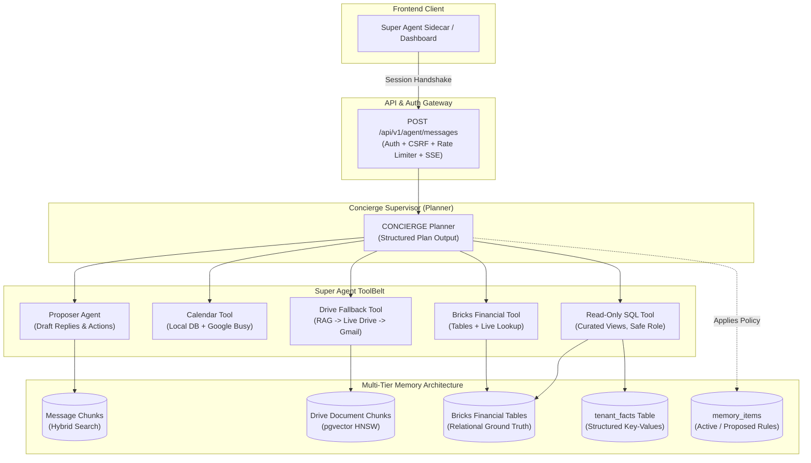
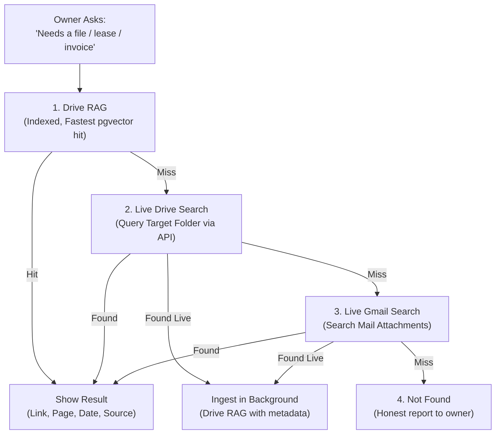
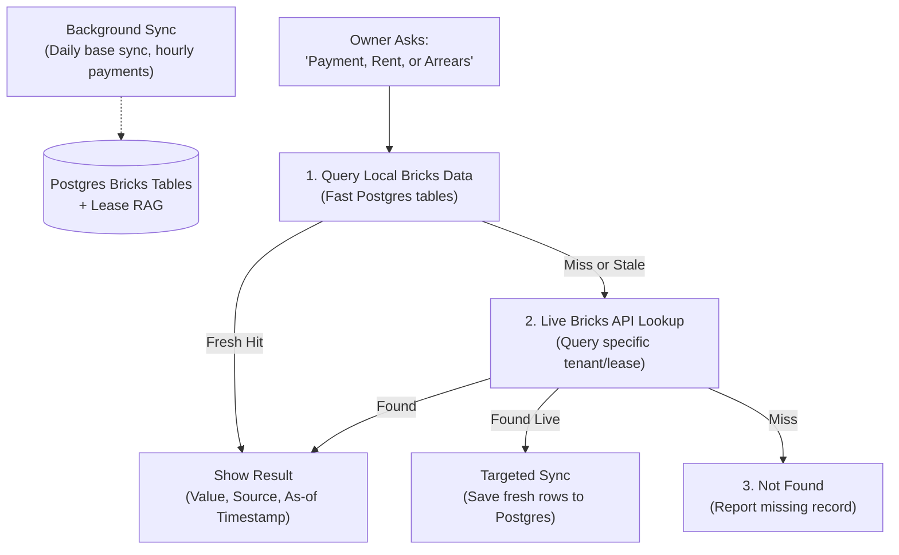

# EstateOS Super Agent & Memory Architecture Redesign
**Document Type:** Architecture Decision & Strategy Blueprint  
**Date:** October 31, 2026  
**Status:** Approved for Implementation (Planning Phase)  
**Target Codebase:** `realestateos` (Backend) & `frontend` (Dashboard UI)  

---

## 1. Executive Summary & Core Decisions

Following the October 31 deep audit and collaborative design session, the EstateOS Super Agent architecture is evolving from a fragile monolithic `/api/agent/ask` prototype into a **production-grade, multi-store memory and tool execution system**.

### Key Architectural Shifts:
1. **Retiring `/api/agent/ask` $\longrightarrow$ Moving to `/api/v1/agent/messages`:**
   * Full session authentication, CSRF protection, SSE streaming, turn-based idempotency, and durable worker queues (`DBOS`).
2. **Three-Tier Separation of Memory & RAGs:**
   * **Message Chunks RAG:** Fast hybrid retrieval over tenant and thread communications.
   * **Drive Documents RAG:** Unverified, human-uploaded lease agreements, invoices, photos, and inspection PDFs.
   * **Bricks Data Engine (Proof-Grade):** Structured financial ledgers, rent receipts, arrears, and official tenant profiles.
3. **Safe Tool Execution with Read-Only SQL Engine:**
   * A sandboxed, read-only SQL querying tool over curated database views for flexible analytical queries (e.g. *"Show tenants with unpaid rent > 30 days"*), while mutations remain strictly gated by typed tools and owner approvals.
4. **PostgreSQL as the Single Source of Truth:**
   * Zero external vector DB dependencies. Embeddings, metadata, relational entities, full-text indexes, and audit logs live atomically in Postgres.

---

## 2. Target Component Architecture

---

## 3. Deep Dive: Memory & Retrieval Architecture

### A. Communications & Message RAG (`message_chunks`)
* **Finding:** 121 of 128 messages are currently unlinked to formal cases.
* **Architecture:**
  * Do not maintain 300 isolated vector collections.
  * Use **one shared table `message_chunks`** indexed on `(company_id, channel, thread_ref, person_id)`.
  * **Hybrid Search:** Combines BM25 / Dutch `tsvector` with dense embeddings (`pgvector`) using Reciprocal Rank Fusion (RRF).
  * Always return verbatim message text with date and sender metadata; never let LLM summarize before grounding.

### B. Drive Document Retrieval (The 4-Stage Fallback Chain)

### C. Bricks Financial Engine (The Proof-Grade Chain)

### D. Calendar Scheduling & Tracking (Postgres-First, No RAG)

```mermaid
flowchart TD
    subgraph Booking ["1. Book a Visit"]
        A1["Parse Request<br/>(Unit, Time, Who)"] --> A2["Check Overlaps<br/>(DB + Google Free/Busy)"]
        A2 --> A3["Save Proposed<br/>(Status: Proposed, Unique Key)"]
        A3 --> A4["Owner Approves<br/>(Push to Google Calendar API)"]
    end

    subgraph AfterVisit ["2. Post-Visit Completion"]
        B1["Mark Done<br/>(Status: Confirmed/Done)"] --> B2["Short Summary<br/>(Saved directly on the row)"]
    end

    subgraph Reading ["3. Owner Inquiries"]
        C1["Owner Asks:<br/>'What visits are booked?'"] --> C2["Deterministic SQL Query<br/>(Start/End time filters, ZERO RAG)"]
    end

    subgraph SyncEngine ["4. Background Reconciliation"]
        D1["Sync edits made directly in Google back to Postgres"]
    end
```

---

## 4. Tooling & Guardrail Design

### A. Read-Only SQL Tool (Analytic Superpower)
* **Goal:** Enable the agent to answer arbitrary aggregate questions (*"Who owes more than €2,000 in rent?"*, *"Which units have had >2 plumbing issues this year?"*) without writing brittle custom Python handlers.
* **Security Controls:**
  1. Dedicated unprivileged PostgreSQL role (`estateos_readonly`) with `SELECT` grant only.
  2. Queries restricted to curated database views (e.g. `v_tenant_summary`, `v_case_overview`, `v_arrears_ledger`).
  3. Pre-execution SQL AST validator blocking any `DROP`, `ALTER`, `UPDATE`, `INSERT`, or transaction manipulation.
  4. Strict execution timeout (2,000 ms) and row limit (50 rows max per turn).

### B. Standardizing Embedding Dimensions
* **Database finding:** `documents.doc_embedding` is declared as `vector(1024)`, while earlier embeddings referenced `768`.
* **Decision:** Standardize the entire platform on a single high-accuracy embedding dimension across all tables (`document_chunks`, `message_chunks`, `memory_items`).

### C. Persona & Guardrails Files
* Extract hardcoded prompt personality traits into repository markdown documents:
  * `docs/agent/persona.md`: Tone of voice (concise, professional Dutch/English property manager).
  * `docs/agent/guardrails.md`: Strict boundaries (no unauthorized financial guarantees, mandatory repair budget ceilings, legally vetted disclaimers).

---

## 5. Phased Build Roadmap

| Phase | Milestone | Core Deliverables | Dependencies |
| :-: | :--- | :--- | :--- |
| **Phase 1** | **Database Alignment & Calendar Migration** | • Write Alembic migration `0021_calendar_events.py` • Apply `calendar_events` table to live PostgreSQL • Standardize vector embedding dimension | Current DB |
| **Phase 2** | **Message Chunks RAG & Hybrid Indexing** | • Create `message_chunks` table & Alembic migration • Implement chunking & Dutch/English tsvector + HNSW • Deploy hybrid RRF search | Phase 1 |
| **Phase 3** | **Planner Tools & `/api/v1` Endpoint Migration** | • Implement safe read-only SQL tool • Retire/lockdown `/api/agent/ask` • Migrate Frontend `AskEstateOSPanel.tsx` to `/api/v1/agent/messages` | Phase 2 |
| **Phase 4** | **Facts & Summaries Engine** | • Create `tenant_facts` key-value table • Add turn compaction & daily conversation summaries | Phase 3 |
| **Phase 5** | **Bricks Integration** | • Daily sync & hourly payment reconciliation worker • Live fallback query handler for tenant ledgers | Phase 4 |
| **Phase 6** | **Drive Live Search Fallback** | • Live Google Drive API folder scanner • Background ingest on live hit | Phase 5 |

---

*This blueprint documents the consensus reached on October 31, 2026. No code modifications have been made; this serves as the foundational architecture reference for upcoming implementation sprints.*

