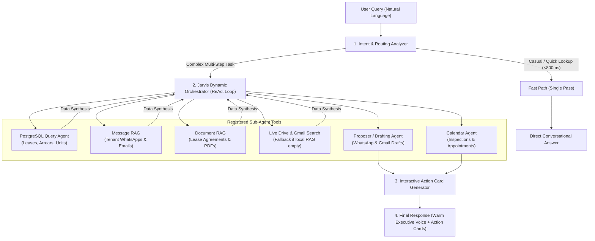

# EstateOS Super Agent 2.0: The "Jarvis" Orchestrator Architecture

> **Purpose:** Architectural blueprint to evolve the EstateOS Super Agent from a rigid, regex-gated command parser into a conversational, omniscient "Jarvis" AI executive.
> **Target Audience:** Engineering Leads & Core AI Developers

---

## 1. Executive Summary & Problem Diagnosis

### Current Reality: Why It Feels Rigid
1. **Regex Gatekeeping:** User queries are intercepted by brittle keyword regexes (`"rule:"`, `"calendar"`, `"lease"`, `"how many"`). If a user phrases a request conversationally (e.g., *"Hey Jarvis, can you check who is behind on rent and prepare a note for them?"*), the regex fails or partially executes.
2. **One-Shot Static Planner (No ReAct Loop):** In `app/llm/agents/concierge.py`, the LLM outputs a single JSON object (`ConciergePlan`). It cannot inspect tool outputs, reason about intermediate findings, or call a second tool.
3. **Data Silos & Starved Context:** The agent is only given the **top 20 open maintenance tickets** in its prompt. It has zero native awareness of:
   - Full property and unit portfolio (occupancy, vacant units, amenities).
   - Leases, deposits, rent amounts, and expiration dates.
   - Comprehensive tenant WhatsApp / Gmail communication history.
4. **Over-Constrained System Prompt:** In `super_agent_prompt.py`, the prompt strictly commands:
   > *"State only what the data shows... Limit your answer to 2-4 crisp bullet points or 1 short paragraph."*
   It explicitly kills casual conversation, greetings, and collaborative brainstorming.

---

## 2. Inventory of Existing Codebase Capabilities

The project **already contains high-performance specialized tools and sub-agents**. They just need an orchestrator to connect them:

| Module / Sub-Agent | File Location | Capabilities |
| :--- | :--- | :--- |
| **1. Database Query Agent** | `app/tools/query_agent/` | Safe read-only NL-to-SQL for PostgreSQL (units, leases, rent arrears, tickets). |
| **2. Message RAG** | `app/tools/message_rag/` | Hybrid search (BM25 + pgvector HNSW) over WhatsApp & Gmail message threads. |
| **3. Document RAG** | `app/pipeline/rag.py` | Hybrid search over lease agreements, contracts, and Google Drive PDFs. |
| **4. Proposer / Drafting Agent** | `app/llm/agents/proposer.py` | Drafts contextual WhatsApp / Gmail messages and contractor work orders. |
| **5. Calendar Agent** | `app/llm/agents/calendar.py` | Proposes appointments, inspections, and checks scheduling conflicts. |
| **6. Morning Briefing Agent** | `app/llm/agents/briefing.py` | Executive morning rollups and daily portfolio health briefs. |
| **7. Memory / Policy Agent** | `app/context/memory_items.py` | Learns and recalls owner preferences and standing company rules (T5). |
| **8. Google Drive & Gmail Sync** | `app/storage/drive.py`, `app/ingestion/gmail_sync.py` | Cloud storage and email ingestion adapters. |

---

## 3. The Target Architecture: Multi-Agent Jarvis Orchestrator



---

## 4. Key Design Patterns

### A. Two-Tier Latency Model (Instant Chat vs. Deep Reasoning)

| Tier | When It Triggers | Execution Model | Target Latency | UI Representation |
| :--- | :--- | :--- | :--- | :--- |
| **Tier 1: Fast Path** | Greetings, simple Q&A, single case status (*"Hi"*, *"What's the status of ticket #104?"*) | 1-shot LLM with lightweight pre-loaded portfolio summary | **< 600ms** | Instant conversational text |
| **Tier 2: Deep Agent Loop** | Multi-source queries, financial calculations, actions (*"Who hasn't paid rent, and draft them a reminder?"*) | Dynamic Tool-Calling Loop (up to 3 tool calls) | **1.5s – 3.5s** | Live step chips: `[🔍 Checked DB]` ➔ `[✍️ Drafted WhatsApp]` |

### B. Interactive Clarification & Live Search Loop

When local RAG yields low confidence or 0 hits:
1. **Never fail silently or output a generic error.**
2. **Clarification Question:**
   > *"I couldn't find a signed lease for Keizersgracht 42-A in our local database. Would you like me to search your live Google Drive or check under the tenant's company name?"*
3. **Action Pills:**
   - `[🔍 Search Live Google Drive]`
   - `[✉️ Search Live Gmail Inbox]`

### C. Safety Guardrails (CLAUDE.md Invariant Compliance)
- **Read-Only Autonomy:** The Super Agent can query anything across PostgreSQL, documents, and messages without human confirmation.
- **Action Propose-Only Rule:** Any mutating action (sending a message, paying an invoice, rescheduling an event) produces a **Staged Approval Card** (`PreviewCardData`) requiring a one-click user authorization.

---

## 5. Technical Implementation Roadmap

### Phase 1: Tool Registry Definition
Convert existing siloed Python functions into callable tools:
```python
# app/api/agent/tools.py
from pydantic_ai import Tool
from app.tools.query_agent.agent import run_query_agent
from app.tools.message_rag.search import search_message_rag
from app.pipeline.rag import search_hybrid
from app.llm.agents.proposer import propose_draft_reply

tools = [
    Tool(run_query_agent, name="query_database", description="Run safe read-only SQL for units, leases, arrears, and tickets"),
    Tool(search_message_rag, name="search_communications", description="Search tenant and contractor WhatsApp/Email messages"),
    Tool(search_hybrid, name="search_documents", description="Search signed PDF contracts, leases, and Google Drive files"),
    Tool(propose_draft_reply, name="draft_message", description="Draft a WhatsApp or Gmail message for owner approval"),
]
```

### Phase 2: Relaxed "Jarvis" Persona
Update `app/context/super_agent_prompt.py`:
- Remove: *"Limit your answer to 2-4 crisp bullet points."*
- Add:
  > *"You are Jarvis, the executive estate intelligence copilot for EstateOS. Speak with natural executive clarity, warmth, and confidence. Engage in open dialogue when asked, proactively coordinate actions across portfolio modules, and accompany every proposal with a structured action card."*

### Phase 3: Live Step Streaming to Frontend
Connect intermediate agent thoughts to the existing `steps: string[]` in `SuperAgentContext.tsx`:
- As tools execute, emit status updates via SSE or turn replay:
  - `"Checked PostgreSQL for overdue rent balances (Found: 1 tenant)"`
  - `"Retrieved last WhatsApp conversation with Pieter Bakker"`
  - `"Drafted polite WhatsApp payment reminder"`

---

## 6. Comparison: Before vs. After

| Capability | Current Super Agent | Super Agent 2.0 ("Jarvis") |
| :--- | :--- | :--- |
| **Conversational Flow** | Rigid, rejects chit-chat, 2-bullet limit | Warm, natural, collaborative brainstorming |
| **Routing Mechanism** | Hardcoded Regex + Static 1-shot JSON plan | Intelligent Intent Classifier + Dynamic ReAct Loop |
| **Database Visibility** | Only sees 20 maintenance tickets | Omniscient: full portfolio, units, leases, ledgers |
| **Multi-Agent Actions** | Cannot chain query + draft | Seamlessly queries database, checks chat, and drafts action cards |
| **Handling Missing Data** | Fails with *"No data found"* | Asks clarifying questions; offers live Drive/Gmail search |
| **Safety Model** | Blocked at planner level | Full read access; explicit 1-click confirmation on write actions |

