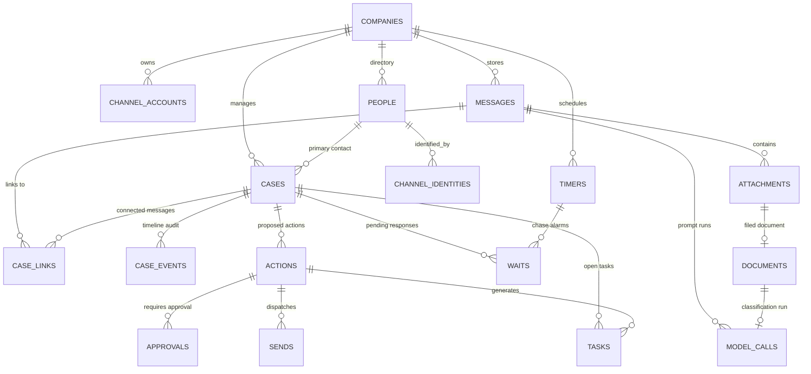

# EstateOS: Complete Project Blueprint & Architecture Guide

> **Purpose:** This document is the comprehensive, end-to-end architectural and file-by-file reference guide for **EstateOS**. It explains the core concepts, data flows, every folder, every critical file, and the database schema from start to finish.
>
> **Stale snapshot, kept for orientation only.** Written early in the project; table count, milestone range and agent
> numbering below no longer match reality, and since 2026-11-14 `app/`, `tests/`, `evals/`, `docker/`, `pyproject.toml`,
> `uv.lock` and `alembic.ini` all live under `backend/` (a sibling of `frontend/`), not at the repo root as the paths
> below still show. For current structure and status read [CLAUDE.md](../CLAUDE.md), [tech-stack.md](tech-stack.md)
> and [PROGRESS.md](PROGRESS.md).

---

## Table of Contents
1. [Executive Summary & Core Concept](#1-executive-summary--core-concept)
2. [End-to-End Architecture & Data Flow](#2-end-to-end-architecture--data-flow)
3. [The 4 Core Pipeline Stages](#3-the-4-core-pipeline-stages)
4. [Complete Folder-by-Folder & File Blueprint](#4-complete-folder-by-folder--file-blueprint)
   - [Root Files](#root-files)
   - [`app/` (Core Application)](#app-core-application)
   - [`docker/`](#docker)
   - [`docs/`](#docs)
   - [`evals/`](#evals)
   - [`tests/`](#tests)
   - [`.github/`](#github)
   - [`.claude/`](#claude)
5. [Database Architecture & Core Tables](#5-database-architecture--core-tables)
6. [Core Invariants & Safety Guardrails](#6-core-invariants--safety-guardrails)
7. [Developer Runbook & Cheat Sheet](#7-developer-runbook--cheat-sheet)

---

## 1. Executive Summary & Core Concept

**EstateOS** is an autonomous, AI-driven property management operations backend designed for a property manager/owner (**Harjot**).

### The Problem It Solves
Property managers receive hundreds of incoming inquiries, maintenance tickets, contractor quotes, and tenant queries across WhatsApp and Email. Triage, assigning contractors, drafting replies, and tracking deadlines consume hours of daily manual effort.

### The EstateOS Solution
EstateOS acts as an AI executive copilot that:
1. **Ingests** messages from **WhatsApp** (tenants/contractors) and **Gmail** (Google Workspace mailbox).
2. **Triages** incoming messages using **Pydantic AI agents** to extract categories, urgency, intent, and entities.
3. **Links** messages to existing cases, properties, and leases in PostgreSQL.
4. **Drafts** 2–3 response variations in Dutch for tenants.
5. **Presents** interactive approval cards to Harjot via **WhatsApp** (buttons: `[Draft 1]`, `[Draft 2]`, `[Edit]`, `[Reject]`).
6. **Strict Safety Policy (Phase 1): It NEVER sends messages directly to tenants!**
   * Approved email replies become **Gmail drafts** in the original email thread.
   * Approved WhatsApp replies are sent **to Harjot on WhatsApp** as copyable text.
7. **Files Attachments** (photos, PDF invoices, leases) directly into **Google Drive** under `EstateOS/<doc_type>/<YYYY>/` using the least-privilege `drive.file` scope.
8. **Automates Follow-ups & Briefings:** Executes daily **07:30** and Friday **16:00** WhatsApp executive briefings, monitors background timers, and automatically follows up with unresponsive tenants or contractors.

---

## 2. End-to-End Architecture & Data Flow

```
Tenants / Contractors                          Harjot (Owner)
  │ WhatsApp (360dialog / Cloud API)             ▲ WhatsApp (Dedicated Agent Number)
  │ Gmail (Workspace Pub/Sub & Pull)             │ (Approve / Edit / Reject buttons, Briefings, Alerts)
  ▼                                              │
┌────────────────────────────── EstateOS Backend ┴─────────────────────────────┐
│ 1. INGESTION (FastAPI)                                                       │
│    - Verifies HMAC signatures / Google OIDC tokens                           │
│    - Deduplicates & inserts into `raw_events` table (Postgres-first)         │
│    - Enqueues durable workflow `process_event`                               │
│                                                                              │
│ 2. AI & DOMAIN PIPELINE (DBOS Worker)                                        │
│    - Inbound Normalization ──► Universal `Message` contract                  │
│    - Understanding Agent ──► Pydantic AI (Category, Urgency, Entities)       │
│    - Case Engine ──► Resolves identity ──► Links/creates Case                │
│    - Proposal Agent ──► Generates typed `Action` with 2–3 draft variations   │
│    - Rules Engine (Pure Python) ──► Enforces permissions & safety policies   │
│                                                                              │
│ 3. OWNER INTERACTION LAYER                                                   │
│    - Delivers interactive WhatsApp cards (button IDs: `apr:<id>:<choice>`)   │
│    - Handles commands (`tasks`, `done`, `snooze`, `waiting`, `pause`, etc.)  │
│    - Supports read-only Owner Q&A agent                                      │
│                                                                              │
│ 4. SENDER (Isolated Module)                                                  │
│    - Only module with send credentials                                       │
│    - Re-verifies approval status, draft version, pause flag, and allowlist   │
│    - Phase 1: Only creates Gmail drafts or sends messages to Harjot          │
│                                                                              │
│ 5. BACKGROUND ENGINE & OBSERVABILITY                                         │
│    - Timers table + DBOS cron (`system.timer_sweep` every minute)            │
│    - Daily 07:30 & Friday 16:00 Executive Briefings                          │
│    - Automated follow-up / chaser ladder                                     │
│    - Attachment filing to Google Drive (`drive.file` scope)                  │
│    - Outcome capture & drift detection (tracks owner edits vs unchanged)     │
│    - Tracing via OpenTelemetry / Langfuse EU; errors via Sentry              │
└──────────────────────────────────────────────────────────────────────────────┘
```

---

## 3. The 4 Core Pipeline Stages

Every time a message arrives from a tenant, the DBOS orchestrator workflow (`pipeline.entry`) runs 4 sequential stages:

```
Inbound Message
      │
      ▼
1. UNDERSTAND (`understand_step` in `app/pipeline/understand.py`)
   - Uses `UNDERSTANDING` agent (`app/llm/agents/understanding.py`).
   - Extracts category (maintenance, payment, lease, etc.), urgency, entities, and suspicious flag.
   - Persists intelligence to `understandings` table and cost/tokens to `model_calls` table.
      │
      ▼
2. RESOLVE SENDER (`resolve_step` in `app/directory/identity.py`)
   - Normalizes phone number (E.164) or email.
   - Matches to an existing `Person` in `channel_identities`.
   - Creates a new `Person` on first contact (Identity-First directory).
      │
      ▼
3. LINK CASE (`link_step` in `app/pipeline/link.py`)
   - Checks if message belongs to an active thread (Gmail threadId or WhatsApp within 72 hours).
   - If sender has 1 open case $\to$ links to it.
   - If sender has 2+ open cases $\to$ calls `LINK_CHECK` AI agent (`app/llm/agents/link_check.py`).
   - If no open cases $\to$ creates a new row in `cases` table.
   - Refreshes rolling case summary via `CASE_SUMMARY` AI agent (`app/llm/agents/case_summary.py`).
      │
      ▼
4. PROPOSE & GUARD (`propose_step` in `app/pipeline/propose.py`)
   - Proposer Agent (`app/llm/agents/proposer.py`) drafts 2–3 response variations in Dutch.
   - Rules Engine (`app/pipeline/rules.py`) validates safety, pause status, and creates SLA tasks.
   - Delivers interactive approval card to Harjot's WhatsApp with buttons: `[d1] [d2] [edit] [rej]`.
      │
      ▼
(Parallel) DOCUMENT FILING (`enqueue_filing` in `app/pipeline/documents.py`)
   - If attachments exist, `DOC_CLASSIFIER` agent inspects metadata (filename, size, type).
   - If confidence $\ge 0.80$, streams file from S3 to Google Drive under `EstateOS/<doc_type>/<YYYY>/`.
```

---

## 4. Complete Folder-by-Folder & File Blueprint

### Root Files
* **`Makefile`**: The central task runner. Maps developer commands to strict quality gates:
  * `make quick` (G1): Linting (`ruff`), type checking (`mypy`), boundary checking (`import-linter`), unit tests.
  * `make check` (G2): G1 + integration tests using Testcontainers (PostgreSQL 16) and migration drift checks.
  * `make up` / `make down`: Manages the Docker Compose development stack.
  * `make sim-demo`: Simulates end-to-end WhatsApp and Gmail traffic through the stack.
  * `make live-check`: Proves real provider credentials (S3, Gmail, WhatsApp, Drive, LLM).
* **`pyproject.toml`**: Single source of truth for Python 3.12 dependencies, tool settings (`ruff`, `mypy`, `pytest`, `import-linter`, `coverage`).
* **`uv.lock`**: Pinned, cryptographically hashed lockfile generated by `uv` for 100% reproducible builds.
* **`alembic.ini`**: Alembic database migration configuration pointing to PostgreSQL and `app/db/alembic/`.
* **`.env.example`**: Complete template listing every environment variable and secret required.
* **`CLAUDE.md`**: Architectural and behavioral guidelines for AI coding assistants working on the repository.

---

### `app/` (Core Application)

#### 1. `app/api/` (HTTP Webhook Entrypoints)
* `main.py`: FastAPI app initialization, middleware, routes, and lifespan.
* `deps.py`: FastAPI dependency injection helpers (database engine, settings, DBOS client).
* `health.py`: Healthcheck endpoints (`/health/ready`, `/health/live`).
* `webhooks/whatsapp.py`: Meta Cloud API & 360dialog webhook endpoint (`POST /webhooks/whatsapp`). Verifies HMAC-SHA256 signature, parses payload, writes to `raw_events`, enqueues background worker, returns 200 fast.
* `webhooks/gmail.py`: Google Cloud Pub/Sub push notification endpoint (`POST /webhooks/gmail/push`). Verifies Google OIDC JWT token.
* `webhooks/google_chat.py`: Google Chat webhook endpoint for Harjot's interactive cards.

#### 2. `app/channels/` (Channel Protocol Handlers)
* `whatsapp/`:
  * `webhook_models.py`: Pydantic models mapping Meta Cloud API JSON structures.
  * `inbound.py`: Extracts text, sender, timestamps, and attachment media IDs from WhatsApp events.
  * `outbound.py`: Formats interactive buttons, list menus, and text messages for WhatsApp.
  * `media.py`: Downloads images/voice notes from Meta/360dialog media servers.
* `gmail/`:
  * `inbound.py`: Parses MIME emails, extracts attachments, cleans text.
  * `drafts.py`: Creates Gmail drafts inside existing email threads (`drafts.create`).
  * `google.py`: Google API client wrapper with exponential backoff.
* `google_chat/`:
  * `outbound.py` & `render.py`: Formats interactive `cardsV2` payloads for Google Chat spaces.

#### 3. `app/contracts/` (Shared Pydantic Schemas)
* `common.py`: Foundational base classes (`Contract`), enums (`Channel`, `Direction`), money, and strict-mode validators.
* `message.py`: Universal normalized message format (`Message` and `Attachment`).
* `understanding.py`: Understanding Agent schema (`Category`, `Urgency`, `Entities`, `Suspicious`, `Understanding`).
* `action.py`: Action proposals (`Action`, `ActionType`, `ReplyDraftPayload` with 2–3 draft variants).
* `proposal.py`: Proposal bundle (`Proposal: list[Action]`).
* `button_id.py`: WhatsApp interactive button format (`apr:<approval_id>:<choice>`).
* `case_state.py`: Case lifecycle states (`open`, `waiting_on_owner`, `waiting_on_third_party`, `resolved`, `closed`).
* `document.py`: Document classification schema (`DocType`, `DocumentClassification`).
* `owner_qa.py`: Owner Q&A response schema (`OwnerAnswer`).

#### 4. `app/core/` (Foundational Utilities)
* `settings.py`: Central `Settings` class powered by `pydantic-settings`.
* `errors.py`: Base `EstateOSError` and specialized exceptions (`NotFoundError`, `AgentFailedError`, etc.).
* `logging.py`: Structured JSON logging configuration via `structlog`.
* `ids.py`: Fast UUIDv7 generation.
* `workflow_names.py`: Centralized workflow and queue string constants.

#### 5. `app/db/` (Database Models & Migrations)
* `base.py`: SQLAlchemy declarative base and `CompanyScoped` mixin.
* `session.py`: Database engine and session factory.
* `models/`:
  * `ingestion.py`: `RawEvent`, `MessageRow`, `AttachmentRow`.
  * `tenancy.py`: `Company`, `ChannelAccount`, `OwnerAccount`, `GmailSyncState`.
  * `directory.py`: `Person`, `ChannelIdentity`, `Unit`, `Lease`.
  * `pipeline.py`: `UnderstandingRow`, `Case`, `CaseLink`, `CaseEvent`, `ActionRow`, `ActionRevision`.
  * `work.py`: `TaskRow`, `WaitRow`, `DocumentRow`.
  * `owner.py`: `Approval`, `OwnerOutbox`, `Send`.
  * `ops.py`: `ModelCall`, `Outcome`, `MetricSnapshot`, `Timer`.
* `alembic/`: Complete versioned database migration scripts (0001 to 0008).

#### 6. `app/directory/` (Identity Resolution)
* `identity.py`: Maps inbound phone numbers and emails to a `Person`. If the contact does not exist, automatically creates a new `Person` and `ChannelIdentity` on first contact.

#### 7. `app/ingestion/` (Raw Event Ingestion & Normalization)
* `process.py`: Core ingestion workflow logic (`ingest.process_event`). Fetches `raw_events`, normalizes into `Message`, saves media to S3, writes `messages` row, and routes message.
* `repository.py`: ACID database operations for raw events, deduplication, and atomic DBOS enqueuing.
* `media.py`: S3 attachment upload streaming and SHA256 checksum calculation.
* `gmail_sync.py`: Serialized Gmail history cursor synchronization.

#### 8. `app/llm/` (AI Agents & Prompts)
* `runtime.py`: Factory that instantiates OpenAI, Gemini, or offline fake models based on `settings.llm_model`. Configures Langfuse OpenTelemetry instrumentation.
* `calls.py`: `run_agent()` wrapper. Manages timeouts, retries, data block escaping, and logs every call to `model_calls`.
* `prompts.py`: Loads and hashes prompt markdown templates (`app/llm/prompts/vN/`).
* `fakes.py`: Deterministic offline `FunctionModel` fakes for unit and integration testing without network calls.
* `agents/`:
  * `understanding.py`: Message triage agent (#2).
  * `link_check.py`: Case disambiguation agent (#3).
  * `case_summary.py`: Rolling case summary agent (#3).
  * `proposer.py`: 2–3 draft reply generator agent (#4).
  * `briefing.py`: Executive morning briefing agent (#7).
  * `doc_classifier.py`: Attachment classifier agent (#9).
  * `owner_qa.py`: Read-only Owner Q&A agent (#10 preview).

#### 9. `app/pipeline/` (Core Business Logic)
* `understand.py`: Executes the Understanding agent and saves `UnderstandingRow`.
* `link.py`: Executes case linking hierarchy and updates rolling summaries.
* `propose.py`: Calls Proposer agent, applies rules, inserts actions, approvals, and tasks.
* `rules.py`: **Pure-Python rules engine**. Zero I/O. Enforces approval policies, exception flags, and company pause switches.
* `documents.py`: Document classification and Google Drive filing logic.
* `document_policy.py`: Standardized Drive folder pathing and naming rules (`YYYY-MM-DD_<type>_<party>_<title>.<ext>`).
* `tasks.py` & `work_repo.py`: Database operations for tasks and follow-up waits.
* `chasing.py`: Automated business-day follow-up chasing ladder.

#### 10. `app/workflows/` (DBOS Durable Workflows)
* `pipeline.py`: Master `pipeline.entry` durable workflow and hourly requeue cron.
* `runtime.py`: DBOS initialization and queue registration.
* `documents.py`: `file_document` workflow.
* `owner_notify.py`: Delivers approval cards and alerts to Harjot.
* `briefings.py`: 07:30 daily and Friday 16:00 briefing scheduled jobs.
* `timer_sweep.py`: Background cron executing every 1 minute to dispatch due timers.

#### 11. `app/owner/` (Harjot's WhatsApp Interface)
* `messages.py`: Pure payload builders for approval cards, list menus, and reply buttons.
* `commands.py`: Command handler for owner text inputs (`tasks`, `done`, `snooze`, `waiting`, `pause`, `resume`).
* `qa.py`: Routes free-form owner questions to the read-only `owner_qa` agent.
* `briefing.py`: Gathers overdue tasks, emergencies, and stats to feed the Briefing agent.

#### 12. `app/sender/` (The Isolated Outbound Sender)
* `execute.py`: **The only module with outbound send credentials**. Re-verifies approval status, draft version, company pause, Phase 1 allowlist, and writes an atomic idempotency key to `sends`.
* **Phase 1 Outbound Actions:**
  * For Email: Calls Gmail API to create a **Draft** in the existing thread.
  * For WhatsApp: Sends copy-ready text **to Harjot on WhatsApp**.
  * **Never sends directly to tenants.**

#### 13. `app/storage/` (Storage Ports & Adapters)
* `s3.py`: AWS S3 client using `boto3`.
* `drive.py`: Google Drive API client using `drive.file` scope. Includes `MemoryDrive` fake for tests.

#### 14. `app/outcomes/` (Feedback & Drift Detection)
* `capture.py`: Inspects Gmail Sent folder and WhatsApp echoes to detect whether Harjot sent the AI draft unchanged, edited it, or rewrote it (using `rapidfuzz`).
* `drift.py`: Daily cron comparing autonomy, cost, and latency against 14-day trailing medians.

#### 15. `app/dev/` (Developer Tools)
* `simulate.py`: Simulates end-to-end inbound traffic and button approvals.
* `gmail_consent.py`: Generates authorized-user OAuth tokens for Gmail and Google Drive.

---

### `docker/`
* `Dockerfile`: Multi-stage production container build using Python 3.12-slim and `uv`.
* `compose.yml`: Local containerized development stack running `postgres`, `migrate`, `api`, and `worker`.

---

### `docs/`
* `hld.md`: High-Level Design document detailing container boundaries, flows, and security.
* `architecture.md`: Visual overview of data ingestion, pipeline stages, and sender isolation.
* `tech-stack.md`: Justification of every chosen technology (DBOS, Pydantic AI, FastAPI, PostgreSQL).
* `build-plan.md`: Roadmap across milestones M0 through M9.
* `PROGRESS.md`: Current milestone tracking and completion evidence.
* `dev-pipeline.md`: The Red-Green-Refactor, G1/G2/G5 gate definitions.
* `go-live-channels.md`: Step-by-step production credential setup guide for S3, Gmail, WhatsApp, Drive, and LLM.
* `adr/`: Architecture Decision Records:
  * `0001-dbos-durable-workflows.md`: Why DBOS replaces Celery/Redis/Beat.
  * `0002-pydantic-ai.md`: Why Pydantic AI replaces custom LLM clients.
  * `0003-whatsapp-pywa-360dialog.md`: Why direct Cloud API / 360dialog was chosen.
  * `0004-import-linter-boundaries.md`: Why import-linter enforces send isolation.
  * `0005-google-drive-filing.md`: Why Google Drive with `drive.file` scope was chosen.
* `superpowers/`: Detailed milestone specifications and implementation plans.

---

### `evals/`
* `golden/`: Golden benchmark datasets (`understanding.yaml`, `linking.yaml`) containing real-world Dutch/English cases.
* `reports/`: Markdown evaluation accuracy reports.
* `run.py`: Evaluation runner powered by `pydantic-evals`.

---

### `tests/`
* `unit/`: Fast unit tests running against deterministic offline fakes (no Docker required).
* `integration/`: Deep integration tests running against PostgreSQL 16 Testcontainers and DBOS.
* `contract/`: Webhook payload parsing tests against recorded HTTP payloads.
* `live/`: Live credential verification tests (run via `make live-check`).
* `fixtures/`: Recorded, anonymized raw webhook payloads from Gmail and WhatsApp.

---

### `.github/`
* `workflows/ci.yml`: GitHub Actions CI pipeline running G1 (lint/types/unit), G2 (integration/testcontainers), Security (`pip-audit`, `gitleaks`), and Docker build.
* `dependabot.yml`: Automated weekly dependency upgrades for `uv`, GitHub Actions, and Docker.

---

### `.claude/`
* `agents/`: AI helper profiles (`estateos-implementer`, `estateos-reviewer`, `test-runner`).
* `hooks/`: Git and editing guardrails preventing accidental credential exposure or architecture boundary violations.
* `skills/`: Developer assistant shortcuts (`/ship`, `/check`, `/new-migration`).

---

## 5. Database Architecture & Core Tables

The PostgreSQL 16 database houses 24 domain tables (plus the internal `dbos` schema). All domain tables are partitioned by `company_id`:



---

## 6. Core Invariants & Safety Guardrails

These non-negotiable rules are enforced by tests, hooks, and linters:

1. **Postgres Before Work:** Everything is written to PostgreSQL before enqueuing a background workflow. Nothing lives only in memory.
2. **Send Isolation:** Only `app/sender/` is permitted to import send credentials or outbound sending adapters. Enforced by `import-linter`.
3. **Phase 1 Never Sends to Tenants:** Outbound actions can only create Gmail drafts in the thread or send messages to Harjot's WhatsApp number.
4. **No Sleeping Workflows:** Workflows execute in seconds/minutes. Human waits (waiting for Harjot to click a button) are stored as database rows, never as sleeping code processes.
5. **Prompt Injection Defense:** Tenant text is strictly treated as untrusted data inside `<message>` delimiters. Models have **no write tools** and can never choose recipients.
6. **Immutable Artifacts:** Committed migrations, published prompts (`app/llm/prompts/vN/`), and recorded test fixtures are never modified in place.

---

## 7. Developer Runbook & Cheat Sheet

### Common Make Commands
```bash
# Setup local environment and pre-commit hooks
make setup

# Start the full local stack (Postgres, API, DBOS Worker)
make up

# Run G1 Quality Gate (Fast: ruff, mypy, import-linter, unit tests)
make quick

# Run G2 Quality Gate (Full: G1 + Testcontainers Postgres integration tests)
make check

# Run end-to-end simulator
make sim-demo

# Check pending approvals in the dev stack
make pending

# Simulate Harjot approving draft 1
make approve n=1 choice=d1

# Run golden set LLM evals
make eval agent=understanding version=v1

# Tear down local stack
make down
```
