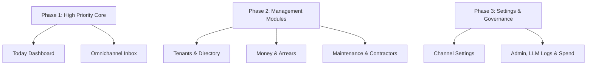

# Frontend Components & Backend Integration Blueprint

> **Objective:** Define all core frontend views to build and the precise backend API contracts connecting Next.js to the EstateOS Python engine.

---

## 1. Phased Component Roadmap (Build Order)

We build the owner's primary daily operating surfaces first:



### Screen Breakdown

| Component / Route | Priority | Core Responsibility |
| :--- | :---: | :--- |
| **`/today` (Today Dashboard)** | **P0 (Immediate)** | Harjot's central morning command screen. High-urgency items, the "Needs You" 2-pane triage queue, KPI counters, rent summary, and autonomous log. |
| **`/inbox` (Omnichannel Inbox)** | **P0 (Immediate)** | Unified chronological message stream (WhatsApp + Gmail + Portal). Thread inspection, AI proposed draft selector, manual reply composer. |
| **`/tenants` (Tenants & Units)** | **P1** | Tenant directory, lease terms (`valid_from` / `valid_to`), contact identities (phone/email), and building/unit associations. |
| **`/money` (Rent & Financials)** | **P1** | Outstanding rent aging buckets (0–30d, 30–90d, 90d+), overdue reminder review trigger, payment logs. |
| **`/maintenance` (Repairs & Dispatches)** | **P1** | Active maintenance cases, contractor dispatch statuses, follow-up ladder progress (chaser step 1, step 2, escalation). |
| **`/properties` (Building Assets)** | **P2** | Real estate assets (e.g. Amsterdam & Rotterdam buildings), occupancy rates (e.g. 94.5%), unit floorplans, and lease statuses. |
| **`/settings` (Channels & Rules)** | **P2** | WhatsApp number status, Gmail watch renew status, business hours, escalation thresholds, automated rules. |
| **`/admin` (Engine Observability)** | **P2** | Live DBOS queue workers, Langfuse trace links, token cost per case, drift alerts, model selection (`gemini-2.5-flash` / `gpt-4o`). |

---

## 2. Deep Dive: Today Dashboard (`/today`)

The Today view is structured into three clear horizontal bands:

```
+-----------------------------------------------------------------------------------------+
| [TOP BAR] Search (/) | ✦ Ask EstateOS Command | Harjot Singh · H R Real Estate B.V.     |
+-----------------------------------------------------------------------------------------+
| [GREETING] "Good morning, Harjot" · Thursday, 1 Oct · 14 messages triaged without you   |
| [KPIS]     [ 6 Needs You ]      [ 1 Urgent SLA ]      [ € 165.734,99 Open Rent ]        |
+-----------------------------------------------------------------------------------------+
| [MAIN SPLIT-PANE: "NEEDS YOU" TRIAGE QUEUE]                                            |
|                                                                                         |
| LEFT PANE: Priority Items (6)                 RIGHT PANE: Active Triage Inspection      |
| ------------------------------------          ----------------------------------------- |
| [Item 1] WhatsApp · Emma van Dijk             Ticket: #cs-0089 · Leaking Radiator       |
|          "Water leaking in living room"       Tenant: Emma van Dijk (Keizersgracht 42-B)|
|          Confidence: 94% · Urgent             Parsed Intent: Emergency Plumber Needed   |
|                                               ----------------------------------------- |
| [Item 2] Gmail · Pieter Bakker                AI Proposal: Dispatch Loodgieter Jansen   |
|          "Question about deposit return"      Draft: "Beste Emma, we hebben..."        |
|          Confidence: 91% · Normal             ----------------------------------------- |
|                                               Actions: [A] Approve Draft 1             |
| [Item 3] WhatsApp · Mark De Vries                     [2] Approve Draft 2             |
|          "Subletting request for summer"              [E] Edit Text   [S] Skip / Next  |
+-----------------------------------------------------------------------------------------+
| [BOTTOM CARDS]                                                                          |
| [ Open Rent & Aging Buckets ]           [ Occupancy: 94.5% ]     [ Handled Without You] |
+-----------------------------------------------------------------------------------------+
```

---

## 3. Backend Integration Architecture

The backend (`d:/estateos/realestateos`) runs FastAPI on port `8000`. To serve the frontend, we add an `app/api/dashboard.py` router that surfaces read models and action mutations.

### REST API Endpoints Required

```
GET  /api/dashboard/today          -> Aggregated snapshot for the Today view
GET  /api/triage/queue             -> List of items currently needing Harjot
GET  /api/triage/queue/{id}         -> Full detail of one pending triage item
POST /api/triage/queue/{id}/decide -> Harjot's approval/edit/reject decision
GET  /api/inbox/threads            -> Unified inbox conversation list
GET  /api/inbox/threads/{id}       -> Full message history & attachments for a thread
POST /api/inbox/threads/{id}/send  -> Direct message or draft send
GET  /api/tenants                  -> Tenant list with unit and lease info
GET  /api/money/arrears            -> Outstanding rent aging buckets
GET  /api/maintenance/cases        -> Active repair tickets & contractor status
GET  /api/health/services          -> Live status of WhatsApp, Gmail, DBOS worker
```

### JSON Contract Example: `GET /api/dashboard/today`

```json
{
  "greeting": {
    "owner_name": "Harjot",
    "company_name": "H R Real Estate B.V.",
    "date": "2026-10-13",
    "autonomous_actions_count": 142
  },
  "kpis": {
    "needs_you_count": 6,
    "urgent_count": 1,
    "open_rent_total_eur": 165734.99,
    "occupancy_percentage": 94.5
  },
  "triage_queue": [
    {
      "id": "appr_7f9c1b3a",
      "channel": "whatsapp",
      "sender_name": "Emma van Dijk",
      "sender_contact": "+31612345678",
      "unit_label": "Keizersgracht 42-B",
      "urgency": "emergency",
      "category": "maintenance",
      "confidence": 0.94,
      "summary": "Water leaking from main radiator valve",
      "received_at": "2026-10-13T09:15:00Z",
      "drafts": [
        {
          "version": 1,
          "text": "Beste Emma, we hebben direct Loodgieter Jansen ingeschakeld. Hij neemt binnen 30 minuten contact op.",
          "type": "whatsapp"
        },
        {
          "version": 2,
          "text": "Beste Emma, kunt u de hoofdkraan onder de gootsteen dichtdraaien? Een loodgieter is onderweg.",
          "type": "whatsapp"
        }
      ]
    }
  ]
}
```

### JSON Contract Example: `POST /api/triage/queue/{id}/decide`

```json
// Request Body
{
  "decision": "approve", // "approve" | "edit" | "skip" | "reject"
  "draft_version": 1,
  "custom_text": null
}

// Response
{
  "status": "success",
  "action_id": "act_82b9a7c1",
  "remaining_queue_count": 5
}
```

---

## 4. State Management & Real-Time Sync

1. **Optimistic Updates:** When Harjot presses `[A]` on an approval card, TanStack Query removes the item from the local list instantly, recalculates the badge counter `6 → 5`, and displays the next item in the right pane.
2. **Polling / SSE Synchronization:**
   - TanStack Query polls `/api/dashboard/today` every 15–30 seconds when window is focused (`refetchInterval: 15000`).
   - Server-Sent Events (SSE) `/api/events/stream` can broadcast `new_inbound_message` and `timer_due` directly from DBOS workflows.
